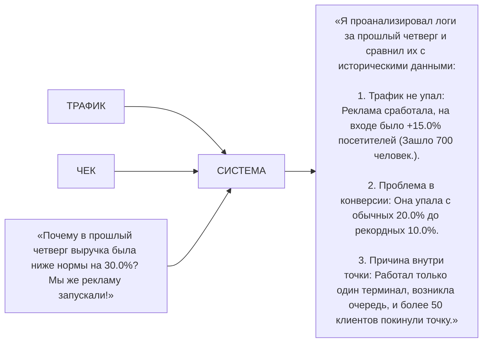
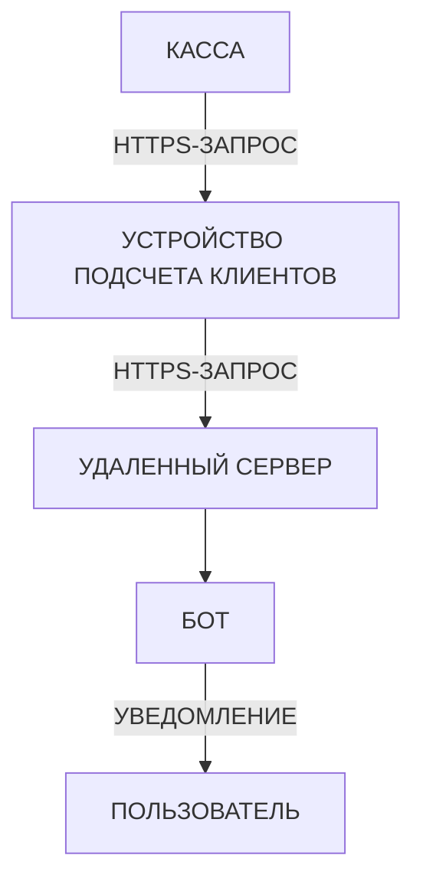
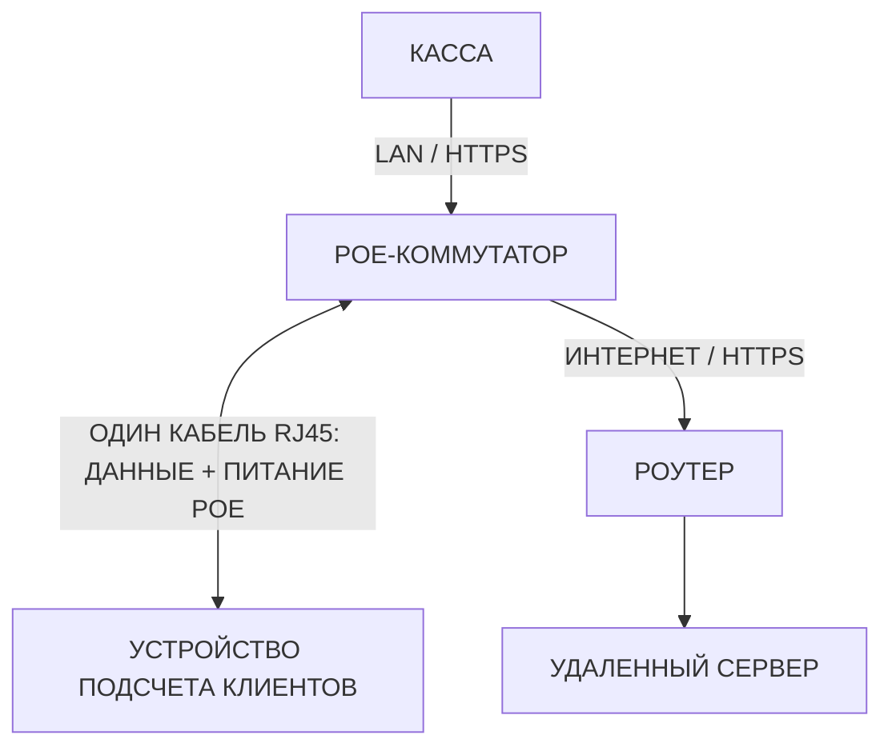

# AN AI RETAIL PLATFORM FOR OFFLINE STORE CONVERSION ANALYSIS

**ИИ-платформа для ритейла, объединяющая компьютерное зрение и локальные языковые модели для мгновенного анализа конверсии точек среднего бизнеса.**

**An AI retail platform combining CV and LLMs for offline store conversion analysis.**

Менеджмент и владельцы точек следят за метриками в реальном времени, получают прогнозы и уведомления об аномалиях через удобный Telegram-бот. Система автоматически собирает регулярные дайджесты и предоставляет простые ответы на любые аналитические вопросы пользователя на человеческом языке.

**Основная идея ИИ-платформы заключается в объединении данных о трафике точек и закрытых чеках для точного прогнозирования продаж и максимизации прибыли.**

Вдохновением при создании концепции послужила экосистема офлайн-магазинов без очередей [Amazon Go](https://www.aboutamazon.com/news/company-news/amazon-fresh-go-stores-closing-expanding-whole-foods).

Retail-focused computer vision MVP project.

Inspired by [Amazon Go](https://www.aboutamazon.com/news/company-news/amazon-fresh-go-stores-closing-expanding-whole-foods) project.

|  |
| :--: |
| **The Espresso Lab at D3 - [Источник](https://studiom.co/work/the-espresso-lab-d3)** |
|  |

**Сегмент рынка:** Максимальный потенциал: *Кофейни, пекарни, кондитерские и др..* С меньшим потенциалом: *Шоурому и др..*

**Экономика и модель:** *ПО (SaaS) (Ежемесячная подписка на ИИ аналитику.). Владелец точки приобретает устройство по себестоимости. (Пока на этапе проработки.)*

## Цель (Goal)

Простая аналитика для среднего бизнеса *(10 - 100 точек.)*. Менеджмент следит через Telegram-бот за метриками в реальном времени, получает прогнозы и важные уведомления. Система собирает регулярные дайджесты и понятно предоставляет простые ответы пользователю на любые вопросы по показателям.

Simple analytics for medium businesses. Management tracks real-time metrics, receives forecasts, and gets critical notifications via a Telegram bot.

The goal is to optimize the interaction between management and analytics for medium businesses, enabling real-time data tracking of key metrics and predictions based on received metric data.

> **Пример уведомления:** «Внимание! За последние 2 часа трафик на входе вырос в 2 раза.» «Внимание! Конверсия выросла на 2.0% по сравнению с понедельником. Это связано с ... Рекомендую ...»
>
> **Пример уведомления:** «Внимание! Аномалия на точке X. За последние 60 минут (13:00 - 14:00) входящий трафик вырос в 2 раза *(Зашло 180 человек вместо обычных 85 для этого времени.)*. При этом количество закрытых чеков на кассе снизилось на 15% *(Пробито всего 8 чеков.)*.»
>
> **Пример ответа на вопрос пользователя:**
>
> **Пользователь:** «Почему во вторник упала выручка?
>
> **Ответ системы:** «Во вторник с 15:00 до 18:00 лил сильный дождь. Трафик упал на 40%. При этом средний чек вырос на 500 рублей, что частично компенсировало спад.»
>
> **Пользователь:** «Что скажешь о данных за прошедший год по сравнению с текущим?»
>
> **Ответ системы:** «В текущем году удалось значительно увеличить конверсию. Рост составил ... Принятые решения позволили ...»
>
> **Пример дайджеста:** «Итоги недели: Конверсия составила 15.5%. +1.5% к прошлой неделе. Самый эффективный день - четверг. Акция на ... сработала отлично! Рекомендую ...»
>
> **Digest example:** «Weekly summary: Conversion rate was 15.5%. +1.5% compared to last week. The best day was Thursday. The promo on ... worked great! I recommend ...»

*Вышепредставленные примеры показывают всего лишь направление мысли, а не итог работы системы.*

**Принцип работы:**


## Задачи

**Одной из задач данного проекта является разработка работающего прототипа конечного устройства (MVP) для запуска пилота и проверки ключевых гипотез.**

> [!WARNING]
> В связи с чем строгое следование стандартам проектирования на данном этапе не предусмотрено.

## Описание системы

Архитектурно система состоит из кассы, удаленного сервера, на котором работает LLM, устройства для подсчета клиентов. Последнее фиксирует количество вошедших клиентов, получает данные от касс заведений о закрытых чеках, агрегирует эти сведения и отправляет их на сервер.
Подключение устройства к кассам и сети Интернет осуществляется по проводному интерфейсу с использованием защищенного протокола `HTTPS`. Располагается устройство у входа в заведение и предназначено для подсчета вошедших и вышедших клиентов (+1/-1).

Сервер функционирует как центральное хранилище данных и интеллектуальное ядро платформы. Развернутая на сервере языковая модель (LLM) интегрирована с реляционной базой данных. Модель не занимается математическими расчетами напрямую, а выступает в роли «ИИ-ассистента». Она переводит корреляцию между сырыми логами трафика и кассовыми чеками в понятные текстовые ответы на запросы пользователей, выявляет аномалии точки и автоматически формирует регулярные дайджесты для менеджмента через интерфейс Telegram-бота.

**Архитектура системы:**



Устройство и касса точки подключаются к PoE-коммутатору по проводному интерфейсу.

**Схема подключения:**



## Описание устройства

Устройство представляет собой компактный вычислитель с камерой, предназначенный для подсчета клиентов, сбора данных с касс заведений, их агрегации, обработки и последующей отправки на удаленный сервер. Устройство имеет один порт Ethernet.

|  |  |
| :--: | :--: |
| **Вариант 1 - Концепт устройства - [Источник]()** |**Вариант 2 - Концепт устройства - [Источник]()** |
|  |  |
| **Вариант 3 - Концепт устройства - [Источник]()** |**Вариант 4 - Концепт устройства - [Источник]()** |
|  |  |
| **Вариант 5 - Концепт устройства - [Источник]()** |**Вариант 6 - Концепт устройства - [Источник]()** |
|  |  |

*(Пока на этапе проработки. Дополнительные ИИ-концепты устройства возможно посмотреть в директории [doc/images](doc/images).)*

Питание устройства осуществляется через порт (PoE) Ethernet (RJ45). *(Один кабель для передачи данных и для питания устройства.)*

## Железо (Hardware)

Для создания прототипа устройства (MVP) и отладки встраиваемого ПО используется:

* **Основной вычислитель:** [Raspberry Pi 5](https://www.raspberrypi.com/products/raspberry-pi-5) для обработки видео потока, развертывания Web-сервера, агрегации данных.
* **ИИ ускоритель (NPU):** [Hailo-8l](https://www.raspberrypi.com/products/ai-kit) для ускорения вывода модели, используемой в задаче подсчета клиентов.
* **Камера:** [Raspberry Pi Camera Module 3](https://www.raspberrypi.com/products/camera-module-3)

|  |  |
| :--: | :--: |
| **Модуль Hailo-8l и плата расширения M.2 - [Источник](https://www.raspberrypi.com/news/raspberry-pi-ai-kit-available-now-at-70)** |**Raspberry Pi и плата расширения M.2 с модулем Hailo-8l - [Источник](https://www.raspberrypi.com/news/raspberry-pi-ai-kit-available-now-at-70)** |
|  |  |
| **Модуль Hailo-8l - [Источник](https://www.raspberrypi.com/news/raspberry-pi-ai-kit-available-now-at-70)** |**Raspberry Pi Camera Module 3 - [Источник](https://www.raspberrypi.com/products/camera-module-3)** |
|  |  |

## Зависимости

**Для сборки и запуска:**

* **Компилятор C++:** С поддержкой C++20 и выше.
* **Python:** Python3
* **HailoRT:** Для вывода модели (Версия 5.4).
* **OpenCV:** Для захвата видео (Версия 4).
* **Система сборки:** CMake (Версия 3.10).

## Результат

**Пример лога при успешном запуске:**

```bash
=== Запуск системы ===
[1/3] Запуск счетчика клиентов...
[2/3] Запуск скрипта записи чека...
[3/3] Запуск скрипта отправки данных на удаленный сервер...
Система успешно запущена!
```

**Пример лога при успешном запуске пайплайна счетчика клиентов:**

```bash
[ИНФО] [Pipeline] Инициализация счетчика клиентов...
...
```

## Техническое описание

Для обнаружения объектов применяется предобученная модель [YOLO26n](https://huggingface.co/Ultralytics/YOLO26) от Ultralytics. Предобученную модель возможно использовать из директории [models](models).

Dataset представляет составляет 2500 кадров в формате YOLO. Dataset возможно использовать из []();

Устройство с периодичностью 5 минут в формате JSON производит отправку агрегированных данных на удаленный сервер.

**Формат данных передаваемых на удаленный сервер:**

```json
{
    "meta": {
        "version": 1,
        "subversion": 0
    },
    "device_id": 0,
    "interval_start": "2026-10-21T09:00:00Z",
    "interval_end": "2026-10-21T09:05:00Z",
    "data": {
        "visitors_in": 1,
        "visitors_out": 1,
        "receipts_count": 1,
        "total_revenue": 5000.0
    },
    "diagnostic": {
        "device_state": "OK"
    }
}
```

**Ключевые параметры:**

* **interval_start:** Дата и время начала периода агрегации данных (ISO 8601).
* **interval_end:** Дата и время окончания периода агрегации данных (ISO 8601).
* **data:** Блок с метриками за указанный интервал.
* **diagnostic:** Информация о текущем состоянии устройства.

После успешного закрытия чека на кассе данные в формате JSON автоматически передаются на устройство. Устройство производит запись полученных данных в конец во временный лог-файл с расширением `.log`.

**Формат данных записываемых при закрытии чека:**

```json
{"timestamp": "2026-10-21T09:00:00Z", "receipt_id": 0, "total_revenue": 0.0}
```

**Ключевые параметры:**

* **receipt_id:** Идентификатор чека (ID).
* **total_revenue:** Общая выручка.

Для проверки работоспособности и корректности отправки данных на устройство с кассы возможно использовать утилиту `curl` с POST-запросом.

**Шаблон запроса:**

```bash
curl -X POST "http://X.X.X.X:X/receipts" -H "Content-type: application/json" -d '{"receipt_id": "X", "total_revenue": X}'
```

Текущий формат логирования можно расширить данными о сменщике и составе чека. Например, указывать, какой именно сотрудник закрыл чек, а также детализировать количество и наименование проданных товаров. Это сделает последующий анализ данных с помощью LLM более глубоким и емким. *(Пока на этапе проработки.)*

**Дополненный формат данных записываемых при закрытии чека:**

```json
{
  "timestamp": "2026-10-21T09:00:00Z",
  "receipt_id": "",
  "total_revenue": 500.00,
  "employee": {
    "id": "0",
    "name": "",
    "role": ""
  },
  "items": [
    {
      "item_id": "0",
      "name": "",
      "quantity": 1,
      "price_per_unit": 500.00,
      "total_item_price": 500.00
    }
  ]
}
```

*(Пока используется упрощенный вариант формата данных.)*

С периодом в 1 минуту счетчик клиентов производит запись полученных данных во временный лог-файл, также имеющий расширение `.log`.

**Формат данных записываемых счетчиком клиентов:**

```json
{"timestamp": "2026-10-21T09:00:00Z", "visitors_in": 0, "visitors_out": 0}
```

**Ключевые параметры:**

* **visitors_in:** Количество клиентов вошедших в заведение.
* **visitors_out:** Количество клиентов вышедших из заведения.

> [!WARNING]
> Все `.log` файлы записываются во временный каталог Linux `/tmp`.

Для проверки работоспособности и корректности отправки данных на удаленный сервер возможно использовать [test.py](scripts/test.py).
Для проверки работоспособности и корректности отправки данных на устройство с кассы возможно использовать [cashbox_test.py](scripts/cashbox_test.py).

## Нерешенные проблемы

* [ ] Проблема очередей у входа точки.
* [ ] Проблема агрегации данных с нескольких устройств в одной точке, если точка имеет несколько входов.
* [ ] Проблема агрегации данных с нескольких точек одной организации.

*(Пока на этапе проработки.)*

##


